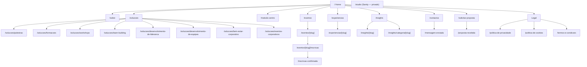

# Fase 1.2 — Sitemap, URLs e navegação

## Sitemap



## Inventário de URLs

Legenda de renderização: **SSG** = estático no build; **ISR** = estático e revalidado sob pedido quando o CMS publica; **Dinâmico** = renderizado por pedido.

| URL | Página | Fonte de conteúdo | Renderização | Indexável | Schema.org |
| --- | --- | --- | --- | --- | --- |
| `/` | Home | Sanity (`homePage` + coleções) | ISR | Sim | `Organization`, `WebSite` |
| `/sobre` | Sobre a Conexão Positiva | Sanity (`aboutPage`, `teamMember`) | ISR | Sim | `AboutPage`, `BreadcrumbList` |
| `/solucoes` | Soluções (índice) | Sanity (`service`) | ISR | Sim | `BreadcrumbList` |
| `/solucoes/[slug]` | Página de serviço (8) | Sanity (`service`) | ISR + `generateStaticParams` | Sim | `Service`, `FAQPage`*, `BreadcrumbList` |
| `/metodo-centro` | Método C.E.N.T.R.O. | Sanity (`centroPage`, `centroPillar`) | ISR | Sim | `BreadcrumbList` |
| `/eventos` | Agenda (próximos / passados / categoria) | Sanity (`event`) | ISR; filtros no cliente | Sim | `BreadcrumbList` |
| `/eventos/[slug]` | Evento | Sanity (`event`) + vagas (Supabase) | ISR; vagas com streaming | Sim | `Event`, `BreadcrumbList` |
| `/eventos/[slug]/inscricao` | Formulário de inscrição | Sanity + Supabase | Dinâmico | Não (`noindex`) | — |
| `/inscricao-confirmada` | Confirmação | Estático | SSG | Não | — |
| `/experiencias` | Experiências / portefólio | Sanity (`caseStudy`) | ISR; filtros no cliente | Sim | `BreadcrumbList` |
| `/experiencias/[slug]` | Caso | Sanity (`caseStudy`) | ISR | Sim | `BreadcrumbList` |
| `/insights` | Blog (índice + pesquisa) | Sanity (`article`) | ISR | Sim | `Blog`, `BreadcrumbList` |
| `/insights/categoria/[slug]` | Categoria | Sanity (`category`) | ISR | Sim | `BreadcrumbList` |
| `/insights/[slug]` | Artigo | Sanity (`article`) | ISR | Sim | `Article`, `BreadcrumbList` |
| `/contactos` | Contactos | Sanity (`siteSettings`) | ISR | Sim | `ContactPage` |
| `/mensagem-enviada` | Confirmação de contacto | Estático | SSG | Não | — |
| `/solicitar-proposta` | Pedido de proposta | Sanity (`service` para a lista) | ISR | Sim | — |
| `/proposta-recebida` | Confirmação de proposta | Estático | SSG | Não | — |
| `/politica-de-privacidade` | Política de Privacidade | Sanity (`legalPage`) | ISR | Sim | — |
| `/politica-de-cookies` | Política de Cookies | Sanity (`legalPage`) | ISR | Sim | — |
| `/termos-e-condicoes` | Termos e Condições | Sanity (`legalPage`) | ISR | Sim | — |
| `/studio/*` | Sanity Studio | — | Cliente | Não (bloqueado em `robots.txt`) | — |
| `/sitemap.xml`, `/robots.txt` | SEO técnico | Gerados (`app/sitemap.ts`, `app/robots.ts`) | ISR | — | — |
| 404 / erro | `not-found.tsx`, `error.tsx` | Estático | — | Não | — |

\* `FAQPage` só é emitido quando a FAQ existe de facto na página. Nenhum dado estruturado é emitido com dados inventados (por exemplo, `Event` sem data real não é publicado).

### Decisões de URL

- **Slugs em português, minúsculas, sem acentos** (`desenvolvimento-de-lideranca`). O CMS gera o slug a partir do título e valida o formato.
- **Páginas de confirmação dedicadas** (`/inscricao-confirmada`, `/proposta-recebida`, `/mensagem-enviada`) em vez de apenas mensagens no ecrã: permitem medir conversões de forma fiável, partilhar próximos passos e são resistentes a atualizações da página. São `noindex` e só mostram conteúdo genérico (nunca dados pessoais na URL).
- **Inscrição em URL própria** (`/eventos/[slug]/inscricao`): ecrã focado no mobile, evento pré-selecionado e não editável. A página do evento mantém o CTA "Inscrever-me" fixo no mobile.
- **Filtros de Eventos e Experiências** usam parâmetros (`?filtro=passados`, `?categoria=team-building`) com URL canónica para a listagem base — evitam conteúdo duplicado. As **categorias de Insights** têm páginas próprias e indexáveis, porque têm valor editorial e de SEO.
- **Eventos passados** não são apagados: passam automaticamente para o filtro "Passados" com base na data, mantêm a página (prova social) e deixam de aceitar inscrições.
- **Redirecionamentos** geridos no CMS (`redirect`: origem → destino, 301), para que a equipa possa renomear slugs sem partir links.

## Navegação

### Header (desktop ≥ 1024px)

```
[Logo]   Sobre Nós  Soluções ▾  Método C.E.N.T.R.O.  Eventos  Experiências  Insights  Contactos   [SOLICITAR PROPOSTA]
```

- "Home" é o próprio logótipo (padrão universal; poupa espaço no menu). Fica disponível como item explícito no menu mobile e no rodapé.
- **Soluções ▾** abre um painel com os 8 serviços (nome + linha descritiva) e um link "Ver todas as soluções". Abre por clique e por teclado (não apenas por hover).
- **Header adaptativo**: transparente sobre o hero, ganha fundo e sombra subtil ao fazer scroll; reduz ligeiramente a altura. Sem esconder/mostrar agressivo.
- O item ativo é marcado visualmente e com `aria-current="page"`.

### Header (mobile e tablet < 1024px)

```
[Logo]                      [Proposta]  [☰]
```

- **"Proposta"** permanece visível no header em todos os ecrãs (botão compacto) — o CTA comercial está sempre a um toque.
- O menu hamburger abre um painel em ecrã inteiro com: links principais em tipografia grande, sub-lista de Soluções em acordeão, CTA "Solicitar proposta" em largura total, e contactos rápidos (telefone, e-mail, WhatsApp).
- Acessibilidade do painel: foco preso dentro do painel, `Esc` fecha, foco regressa ao botão, scroll do fundo bloqueado, alvos de toque ≥ 44 × 44 px.

### Rodapé

| Coluna | Conteúdo |
| --- | --- |
| Marca | Logótipo, frase de posicionamento, redes sociais (Instagram, LinkedIn, Facebook, YouTube quando existir) |
| Navegação | Sobre, Soluções, Método C.E.N.T.R.O., Eventos, Experiências, Insights, Contactos |
| Soluções | Os 8 serviços |
| Contacto | Telefone, e-mail, WhatsApp, localização (se fornecida), CTA "Solicitar proposta" |
| Linha legal | © ano Conexão Positiva · Política de Privacidade · Cookies · Termos · Gerir cookies |

Todos os dados do rodapé vêm de `siteSettings` no CMS. Redes sem URL configurado não são mostradas.

### Elementos globais

- **Skip link** "Saltar para o conteúdo" como primeiro elemento focável.
- **WhatsApp flutuante**: canto inferior direito, discreto; no mobile fica acima do CTA fixo das páginas de evento e nunca cobre botões de formulário. Mensagem pré-preenchida: *"Olá! Gostaria de saber mais sobre as soluções da Conexão Positiva."*
- **Banner de consentimento de cookies**: não bloqueia o conteúdo; opções "Aceitar", "Rejeitar" e "Personalizar" com o mesmo peso visual.
- **Breadcrumbs** em todas as páginas de segundo nível ou mais (serviço, evento, caso, artigo).

## Estrutura de secções por página (alto nível)

O detalhe visual e de layout é trabalho da Fase 2 (wireframes). Aqui fixa-se apenas a ordem e o propósito de cada secção.

### Home

| # | Secção | Pergunta a que responde | CTA |
| --- | --- | --- | --- |
| 1 | Hero | Quem são e o que prometem? | Conhecer as nossas soluções · Solicitar uma proposta |
| 2 | Quem somos | Porque devo confiar? | Conhecer a Conexão Positiva |
| 3 | Soluções (8) | O que podem fazer pela minha organização? | Link por serviço |
| 4 | Método C.E.N.T.R.O. (interativo) | O que os torna diferentes? | Descobrir o Método C.E.N.T.R.O. |
| 5 | Experiências | Já fizeram isto antes? | Ver todas as experiências |
| 6 | Impacto (indicadores) | Qual a dimensão do trabalho? | — (oculta enquanto não houver números reais) |
| 7 | Clientes e parceiros | Quem já confiou? | — (oculta enquanto vazia) |
| 8 | Testemunhos | O que dizem os participantes? | — |
| 9 | Próximos eventos | Posso participar? | Ver evento / Inscrever-me |
| 10 | Insights (3 mais recentes) | Sabem do que falam? | Explorar Insights |
| 11 | CTA final | Qual o próximo passo? | Solicitar proposta · Falar connosco |

Regra transversal: **secções sem conteúdo real publicado não são renderizadas** no site público. No CMS, ficam marcadas com placeholders explícitos (ex.: `[Adicionar número real de participantes impactados]`).

### Sobre Nós
Hero → Quem somos → Nossa história → Propósito → Missão / Visão → Valores → Nossa abordagem → Equipa → Liderança/Fundador(a) → CTA.

### Página de serviço (modelo único para os 8)
Hero → Introdução → Problema que resolve → Como funciona → Benefícios → Para quem é → Formatos → Galeria → Experiências relacionadas → Testemunhos → FAQ → CTA "Solicitar uma proposta" (com o serviço pré-selecionado no formulário).

### Método C.E.N.T.R.O.
Hero ("Um caminho para desenvolver pessoas de dentro para fora") → O que é → Porque foi criado → Os seis pilares (scroll storytelling com secção sticky no desktop; acordeão/cartões no mobile) → Como funciona → Para quem é → Aplicação individual → Aplicação corporativa → Resultados esperados → FAQ → CTA "Levar o Método C.E.N.T.R.O. para a minha organização".

### Evento
Hero (imagem, nome, data, hora, local, categoria) → Descrição → Programa → Facilitador(a) → Informação prática (vagas disponíveis, valor) → Galeria → FAQ → CTA "INSCREVER-ME" (fixo no mobile; desativado com "Inscrições encerradas" ou "Esgotado" quando aplicável).

### Caso (experiência)
Hero (fotografia, cliente, categoria) → Desafio → Objetivo → Solução → Participantes → Galeria / vídeo → Resultados → Testemunho → Experiências relacionadas → CTA.

### Artigo
Cabeçalho (categoria, título, autor, data, tempo de leitura) → Imagem → Introdução → Conteúdo (rich text) → Partilha → Autor → Artigos relacionados → CTA.

## Preparação multilingue

- URLs portuguesas sem prefixo (`/sobre`); uma futura versão inglesa ficará em `/en/...` com segmentos traduzidos (`/en/about`, `/en/solutions/team-building`).
- `hreflang` e `x-default` gerados automaticamente quando a segunda língua existir.
- Detalhe técnico no documento de arquitetura.
