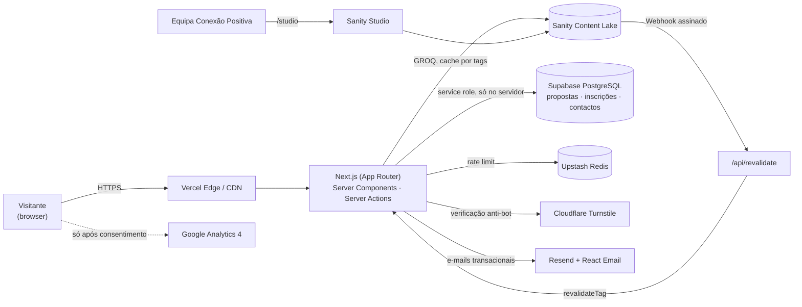

# Fase 1.3 — Arquitetura técnica

## Visão geral



**Separação de responsabilidades**

| Tipo de dado                                                                 | Onde vive                 | Porquê                                                                                        |
| ---------------------------------------------------------------------------- | ------------------------- | --------------------------------------------------------------------------------------------- |
| Conteúdo editorial (páginas, serviços, eventos, artigos, casos, testemunhos) | **Sanity**                | Editável pela equipa sem código, com pré-visualização e histórico                             |
| Dados pessoais e transacionais (propostas, inscrições, contactos)            | **Supabase (PostgreSQL)** | Base de dados relacional segura, com transações (controlo de vagas) e acesso só pelo servidor |
| Contadores efémeros de rate limiting                                         | **Upstash Redis**         | Rápido, serverless, integrado com a Vercel                                                    |

Dados pessoais **nunca** são guardados no Sanity.

## Stack

| Camada                | Tecnologia                                                                                                  | Notas                                                    |
| --------------------- | ----------------------------------------------------------------------------------------------------------- | -------------------------------------------------------- |
| Framework             | **Next.js** (App Router), última versão estável à data da instalação                                        | RSC por defeito; `"use client"` apenas onde há interação |
| Linguagem             | **TypeScript** `strict` (+ `noUncheckedIndexedAccess`)                                                      | Sem `any`; tipos do Sanity gerados com `sanity typegen`  |
| Estilos               | **Tailwind CSS v4** com tokens em CSS variables (`@theme`)                                                  | Paleta substituível num único ficheiro                   |
| Variantes             | `class-variance-authority` + `tailwind-merge`                                                               | Evita classes gigantes repetidas                         |
| Primitivos acessíveis | **shadcn/ui** (Radix) totalmente re-estilizado                                                              | Só os necessários: Dialog, Accordion, Select, Tabs, etc. |
| Ícones                | **Lucide**                                                                                                  | Biblioteca única, traço consistente                      |
| Animação              | CSS por defeito; **Motion** apenas no C.E.N.T.R.O. e reveals, com `dynamic import`                          | `prefers-reduced-motion` respeitado globalmente          |
| Tipografia            | **Manrope** (títulos) + **Inter** (texto) via `next/font`, subconjunto `latin` + `latin-ext`, pesos mínimos | Sem pedidos a Google Fonts em runtime                    |
| CMS                   | **Sanity** + `next-sanity`, Studio embebido em `/studio`, Presentation Tool (edição visual) e Draft Mode    | Campos em português                                      |
| Base de dados         | **Supabase PostgreSQL**                                                                                     | RLS ativo, sem políticas públicas                        |
| Formulários           | **React Hook Form** + **Zod** (schema partilhado cliente/servidor) + Server Actions                         | Validação dupla                                          |
| Anti-spam             | Honeypot + tempo mínimo de preenchimento + **Turnstile** + rate limit (Upstash)                             | Turnstile é invisível na maioria dos casos               |
| E-mail                | **Resend** + **React Email**                                                                                | Templates com a identidade da marca                      |
| i18n                  | **next-intl** (`localePrefix: "as-needed"`)                                                                 | PT sem prefixo hoje; EN preparado                        |
| Analytics             | **GA4** com Consent Mode v2 + Search Console                                                                | Carregado só após consentimento                          |
| Testes                | **Vitest** + Testing Library; **Playwright** + `@axe-core/playwright`; Lighthouse CI                        | —                                                        |
| Qualidade             | ESLint (config Next + TS strict), Prettier, Husky + lint-staged                                             | CI bloqueia em erros                                     |
| Hosting               | **Vercel** (região de funções na Europa, próxima de Luanda e da BD)                                         | Previews por PR                                          |

## Estrutura de pastas

```
conexao-positiva/
├─ messages/                     # textos de interface por língua (pt.json; en.json no futuro)
├─ public/                       # favicon, imagens estáticas mínimas
├─ supabase/
│  └─ migrations/                # SQL versionado (tabelas, RLS, funções)
├─ e2e/                          # testes Playwright
├─ src/
│  ├─ app/
│  │  ├─ [locale]/
│  │  │  ├─ (site)/              # layout com Header, Footer, WhatsApp, Consentimento
│  │  │  │  ├─ page.tsx          # Home
│  │  │  │  ├─ sobre/
│  │  │  │  ├─ solucoes/[slug]/
│  │  │  │  ├─ metodo-centro/
│  │  │  │  ├─ eventos/[slug]/inscricao/
│  │  │  │  ├─ experiencias/[slug]/
│  │  │  │  ├─ insights/[slug]/ · insights/categoria/[slug]/
│  │  │  │  ├─ contactos/ · solicitar-proposta/
│  │  │  │  ├─ inscricao-confirmada/ · proposta-recebida/ · mensagem-enviada/
│  │  │  │  └─ [legal]/          # privacidade, cookies, termos
│  │  │  ├─ not-found.tsx · error.tsx · loading.tsx
│  │  ├─ studio/[[...tool]]/     # Sanity Studio (fora de [locale])
│  │  ├─ api/revalidate/         # webhook do Sanity
│  │  ├─ api/draft-mode/         # pré-visualização
│  │  ├─ sitemap.ts · robots.ts · manifest.ts
│  ├─ components/
│  │  ├─ ui/                     # Button, Input, Select, Badge, Dialog… (primitivos do DS)
│  │  ├─ layout/                 # Header, MobileMenu, Footer, Container, Section
│  │  ├─ common/                 # Breadcrumbs, SkipLink, WhatsAppButton, CookieConsent, SanityImage, PortableText
│  │  ├─ cards/                  # ServiceCard, EventCard, CaseStudyCard, ArticleCard, TestimonialCard
│  │  ├─ sections/               # Hero, CentroExperience, ImpactStats, ClientLogos, Testimonials, CtaBanner, Faq, Gallery…
│  │  └─ forms/                  # ContactForm, ProposalForm, RegistrationForm, FormField, FormStatus
│  ├─ sanity/
│  │  ├─ schemas/                # documents/ e objects/
│  │  ├─ structure.ts            # organização do Studio em português
│  │  ├─ lib/                    # client, fetch com tags, image builder
│  │  └─ queries/                # GROQ por domínio
│  ├─ lib/
│  │  ├─ validation/             # schemas Zod partilhados
│  │  ├─ actions/                # Server Actions (submit*)
│  │  ├─ db/                     # cliente Supabase server-only + repositórios
│  │  ├─ email/                  # envio + templates React Email
│  │  ├─ security/               # rate limit, turnstile, honeypot, sanitização
│  │  ├─ seo/                    # buildMetadata, JSON-LD builders
│  │  ├─ analytics/              # consentimento + trackEvent
│  │  └─ utils/                  # datas (Africa/Luanda), formatação Kz, cn()
│  ├─ hooks/                     # useReducedMotion, useScrolled, useConsent
│  ├─ i18n/                      # routing.ts, request.ts (next-intl)
│  ├─ types/
│  └─ styles/                    # globals.css com tokens do Design System
└─ middleware.ts                 # i18n + headers; exclui /studio, /api, assets
```

Regras: `server-only` em tudo o que toca secrets (`lib/db`, `lib/email`, `lib/security`); componentes de UI não fazem fetching; queries GROQ não vivem dentro de componentes.

## Renderização, cache e performance

- **Estático por defeito.** Páginas de conteúdo são geradas no build e cacheadas na CDN.
- **Revalidação sob pedido.** Cada fetch ao Sanity leva tags (`service`, `event:slug`, …). Ao publicar no Studio, um webhook assinado chama `/api/revalidate`, que verifica a assinatura e invalida só as tags afetadas. Fallback de revalidação temporal longa como rede de segurança.
- **Dados dinâmicos isolados.** As vagas disponíveis de um evento são lidas do Supabase dentro de um componente com `<Suspense>` (streaming), sem tornar toda a página dinâmica.
- **Imagens** via `next/image` com loader do CDN do Sanity (AVIF/WebP automáticos, `sizes` corretos, LQIP como placeholder). A imagem do hero tem `priority`; as restantes são lazy.
- **JavaScript mínimo.** Interatividade em ilhas cliente pequenas: menu mobile, C.E.N.T.R.O., filtros, formulários, consentimento. Motion, galeria/lightbox e Turnstile são carregados com `dynamic import` apenas quando necessários.
- **Vídeo do hero** (se usado): curto, sem som, `poster` como LCP, `preload="none"`, não reproduz com `prefers-reduced-motion` nem em modo de poupança de dados.

## Modelo de conteúdo (Sanity) — visão geral

Detalhe de campos é trabalho da Fase 13. Todos os documentos têm etiquetas, descrições e validações em português.

| Documento                                                            | Tipo                   | Notas principais                                                                                                                                                                                                   |
| -------------------------------------------------------------------- | ---------------------- | ------------------------------------------------------------------------------------------------------------------------------------------------------------------------------------------------------------------ |
| `siteSettings`                                                       | Singleton              | Logótipo, favicon, contactos, WhatsApp, redes sociais, SEO por defeito, rodapé                                                                                                                                     |
| `homePage`, `aboutPage`, `centroPage`, `contactPage`, `proposalPage` | Singletons             | Textos e secções editáveis das páginas fixas                                                                                                                                                                       |
| `impactStat`                                                         | Objeto em `homePage`   | Valor + rótulo + **interruptor "Publicar"**; nunca preenchido por defeito                                                                                                                                          |
| `service`                                                            | Coleção                | Nome, slug, resumo, ícone, imagem, problema, como funciona, benefícios, público, formatos, galeria, FAQ (ref.), SEO, ordem                                                                                         |
| `centroPillar`                                                       | Coleção (6, ordenável) | Letra, nome, descrição curta, ícone, conteúdo, imagem                                                                                                                                                              |
| `event`                                                              | Coleção                | Nome, slug, imagem, início/fim (fuso Africa/Luanda), local, categoria, descrição, programa, facilitador (ref.), vagas, preço (Kz) ou gratuito, estado (rascunho/aberto/esgotado/encerrado/cancelado), galeria, FAQ |
| `caseStudy`                                                          | Coleção                | Cliente (ref.), título, categoria, serviço (ref.), desafio, objetivo, solução, participantes, galeria, vídeo, resultados, testemunho (ref.)                                                                        |
| `testimonial`                                                        | Coleção                | Nome, cargo, empresa, foto, texto, **autorização de publicação confirmada** (obrigatório)                                                                                                                          |
| `client`                                                             | Coleção                | Nome, logótipo (SVG/PNG), website, autorização de uso do logótipo                                                                                                                                                  |
| `article`                                                            | Coleção                | Título, slug, autor (ref.), categoria (ref.), data, imagem, introdução, conteúdo (Portable Text), SEO; tempo de leitura calculado                                                                                  |
| `category`                                                           | Coleção                | Liderança, Pessoas, Equipas, Bem-estar, Desenvolvimento Humano, Produtividade, Método C.E.N.T.R.O.                                                                                                                 |
| `teamMember`                                                         | Coleção                | Nome, cargo, fotografia, biografia, LinkedIn, é fundador(a)                                                                                                                                                        |
| `faq`                                                                | Coleção                | Pergunta, resposta, categoria                                                                                                                                                                                      |
| `legalPage`                                                          | Coleção                | Privacidade, Cookies, Termos (com data de última atualização)                                                                                                                                                      |
| `redirect`                                                           | Coleção                | Origem, destino, permanente                                                                                                                                                                                        |

Preparação i18n: os documentos traduzíveis terão um campo `language` (oculto enquanto só existir PT), compatível com o plugin de internacionalização de documentos do Sanity.

## Base de dados (Supabase) — visão geral

Detalhe e migrations na Fase 14.

| Tabela                | Conteúdo                                                                                                                                     |
| --------------------- | -------------------------------------------------------------------------------------------------------------------------------------------- |
| `proposal_requests`   | Nome, empresa, cargo, telefone, e-mail, serviço, participantes, local, data prevista, objetivo, orçamento (opcional), informações adicionais |
| `event_registrations` | Evento (id + slug do Sanity), nome, sobrenome, e-mail, telefone, empresa, cargo, observações, estado (confirmada/lista de espera/cancelada)  |
| `contact_messages`    | Nome, empresa, e-mail, telefone, assunto, mensagem                                                                                           |

Colunas comuns: `id` (uuid), `created_at`, `status` (para acompanhamento interno), `consent_version`, `consent_at`, `email_status` (pendente/enviado/falhou), `ip_hash` (hash com salt — nunca o IP em claro), `user_agent` truncado.

- **RLS ativo em todas as tabelas, sem políticas para `anon`/`authenticated`**: só o servidor (service role) lê e escreve. A chave nunca chega ao browser.
- **Controlo de vagas sem overbooking**: inscrição feita por uma função PostgreSQL (`register_for_event`) que, numa transação com lock por evento, conta as inscrições confirmadas e decide entre "confirmada", "lista de espera" ou rejeição.
- **Unicidade**: uma inscrição por e-mail por evento (índice único).
- **Retenção**: prazo de conservação a definir com a Conexão Positiva (ver decisões pendentes); job agendado anonimiza/elimina registos expirados.

## Fluxo de formulários

```
Cliente: React Hook Form + Zod (feedback imediato, estados de loading/erro)
  → Server Action
     1. Honeypot vazio e tempo mínimo de preenchimento
     2. Rate limit por IP (Upstash) — ex.: 5 envios / 10 min
     3. Verificação Turnstile no servidor
     4. Validação Zod (mesmo schema) + normalização e sanitização
     5. Insert no Supabase (ou função de inscrição)
     6. E-mails: notificação à equipa + confirmação ao utilizador (Resend)
        — falha de e-mail não perde o registo; fica `email_status = falhou` e é reenviado por cron
     7. Evento de conversão (só com consentimento) → redirect para página de confirmação
```

Mensagens de erro claras e em português; os dados preenchidos nunca se perdem num erro.

## Segurança

- **Headers**: HSTS, `X-Content-Type-Options`, `Referrer-Policy: strict-origin-when-cross-origin`, `Permissions-Policy` restritiva, `frame-ancestors 'none'` (exceto o necessário para a pré-visualização do Studio).
- **CSP**: política com lista explícita de origens (Sanity CDN, Turnstile, GA). Uma CSP com nonce obrigaria a renderizar todas as páginas dinamicamente e anularia o cache estático; por isso o site público usa uma CSP sem nonce mas restritiva, e o `/studio` tem uma política própria. Decisão a validar na Fase 16 com medição.
- **Secrets** apenas em variáveis de ambiente do servidor; só variáveis `NEXT_PUBLIC_*` não sensíveis (project ID do Sanity, site key do Turnstile, ID do GA).
- **Webhook** do Sanity com verificação de assinatura; endpoint de draft mode protegido por secret.
- **Conteúdo do CMS** renderizado via Portable Text (sem `dangerouslySetInnerHTML` com HTML arbitrário).
- **Dependências**: Dependabot/Renovate + `npm audit` no CI.

## Variáveis de ambiente previstas

| Variável                                                                                        | Pública?      | Uso                                           |
| ----------------------------------------------------------------------------------------------- | ------------- | --------------------------------------------- |
| `NEXT_PUBLIC_SITE_URL`                                                                          | Sim           | URL canónico                                  |
| `NEXT_PUBLIC_SANITY_PROJECT_ID`, `NEXT_PUBLIC_SANITY_DATASET`, `NEXT_PUBLIC_SANITY_API_VERSION` | Sim           | Leitura de conteúdo                           |
| `SANITY_API_READ_TOKEN`                                                                         | **Não**       | Drafts / pré-visualização                     |
| `SANITY_REVALIDATE_SECRET`                                                                      | **Não**       | Webhook de revalidação                        |
| `SUPABASE_URL`, `SUPABASE_SERVICE_ROLE_KEY`                                                     | **Não**       | Base de dados (só servidor)                   |
| `UPSTASH_REDIS_REST_URL`, `UPSTASH_REDIS_REST_TOKEN`                                            | **Não**       | Rate limiting                                 |
| `NEXT_PUBLIC_TURNSTILE_SITE_KEY` / `TURNSTILE_SECRET_KEY`                                       | Sim / **Não** | Anti-bot                                      |
| `RESEND_API_KEY`, `EMAIL_FROM`, `EMAIL_TEAM_TO`                                                 | **Não**       | E-mails                                       |
| `IP_HASH_SALT`                                                                                  | **Não**       | Hash de IP                                    |
| `NEXT_PUBLIC_GA_MEASUREMENT_ID`                                                                 | Sim           | Analytics                                     |
| `CRON_SECRET`                                                                                   | **Não**       | Jobs agendados (reenvio de e-mails, retenção) |

Um `.env.example` sem valores reais será criado na Fase 4.

## Analytics e consentimento

- Banner com categorias: Necessários (sempre ativos), Estatística (GA4). Decisão guardada num cookie próprio com versão; "Gerir cookies" no rodapé reabre o painel.
- GA4 com **Consent Mode v2** em `denied` por defeito; o script só carrega após "Aceitar".
- Eventos: `generate_lead` (proposta/contacto), `sign_up` (inscrição), `contact_whatsapp`, `select_content` (clique em serviço), `view_item` (evento visualizado).
- Search Console verificado por DNS; sitemap submetido no lançamento.

## SEO técnico

- `generateMetadata` em todas as rotas a partir de um helper único (title template `%s | Conexão Positiva`, description, canonical, Open Graph, Twitter cards); campos SEO opcionais no CMS com fallback automático.
- Imagens sociais: a do documento no CMS ou, na falta, uma imagem OG gerada (`opengraph-image.tsx`) com a identidade da marca.
- JSON-LD gerado por builders tipados; só emitido com dados reais.
- `sitemap.xml` dinâmico (inclui `lastModified` do Sanity) e `robots.txt` que bloqueia `/studio`, `/api` e páginas de confirmação.

## Acessibilidade (requisitos transversais)

WCAG 2.2 AA: HTML semântico e landmarks; um `h1` por página; skip link; foco visível de alto contraste; navegação completa por teclado (incluindo o C.E.N.T.R.O. e o menu Soluções); alvos ≥ 24 px (≥ 44 px no mobile); labels e mensagens de erro associadas (`aria-describedby`); contraste ≥ 4,5:1 no texto; `prefers-reduced-motion`; carrosséis com pausa e controlos; alt text obrigatório no CMS para imagens de conteúdo.

## Testes e CI

- **Unit**: schemas Zod, utilitários de datas/preço, builders de SEO/JSON-LD.
- **Componentes**: formulários (estados), CentroExperience (teclado), MobileMenu (focus trap).
- **E2E (Playwright)**: enviar contacto; solicitar proposta; inscrever-se num evento; navegar para serviço; abrir experiência; ler artigo. Executados em Chromium, WebKit e Firefox, em viewports 360/390/768/1280/1440, com verificação axe.
- **Lighthouse CI** com orçamentos (Performance ≥ 90; Acessibilidade, Boas práticas, SEO ≥ 95).
- **Pipeline** (GitHub Actions): lint → typecheck → unit → build → E2E contra o preview da Vercel.

## Deploy e domínio

- Vercel: produção a partir de `main`, preview por pull request, variáveis de ambiente separadas por ambiente (Production / Preview / Development).
- Sanity: datasets `production` e `development`; CORS configurado para o domínio e previews; webhook de revalidação apontado para produção.
- Domínio (ex.: `conexaopositiva.ao`): DNS na Vercel ou registos A/CNAME no registrador; SSL automático; `www` → domínio sem `www` com 301 (ou o inverso, a decidir); canonical sempre o domínio final.
- E-mail transacional: domínio verificado na Resend com SPF, DKIM e DMARC.
- Backups: exportação agendada do dataset Sanity (`sanity dataset export`) e backups diários do Supabase (plano pago) ou `pg_dump` agendado.
